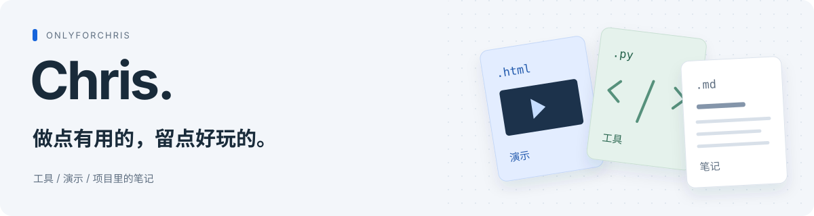

有 HTML 演示、财务小工具，也有招聘和文档处理的 Skill。项目放在这里，做的过程中遇到的问题记在博客里。

[作品与笔记](https://onlyforchris.github.io/blog/) · [全部仓库](https://github.com/onlyforchris?tab=repositories) · [关于我](https://onlyforchris.github.io/blog/about/)

## 做过的东西

### [HTML 幻灯片](https://github.com/onlyforchris/html-ppt-apple-style)

把演示做成一个 HTML 文件，浏览器打开就能放映。可以直接改模板，也可以作为 Skill 使用。

[打开博客演示](https://onlyforchris.github.io/blog/apple-demo.html) · [取用模板](https://github.com/onlyforchris/html-ppt-apple-style/blob/master/assets/apple-ppt-template.html)

### [财小盒](https://github.com/onlyforchris/caixiaohe)

Windows 桌面财务工具：发票查重、归档，加上现金流预测。账本保存在本机；可选云端 OCR 会涉及票据上传，使用前请确认配置。

### [JD 简历匹配](https://github.com/onlyforchris/match-resumes-to-jd)

先从 JD 建岗位画像，再逐份整理简历证据和待核验问题。没写不等于不符合，也不编一个看似精确的分数。需要支持 Skill 的 AI 工具。

### [公众号草稿发布](https://github.com/onlyforchris/wechat-draft-publisher-skill)

Markdown 转微信排版、上传图片、创建草稿。到草稿箱为止，不直接群发；需要公众号 API 凭据。

基于 [wechat-publisher](https://github.com/jiji262/wechat-publisher) 裁剪的衍生版本。

### [中文标书辅助](https://github.com/onlyforchris/bid-response-production)

把招标要求、响应内容和证据材料对应起来，辅助审查与 Word 排版。缺材料的地方留给人核实，不替代业务或法务审核。

### [Agent Hub](https://github.com/onlyforchris/agent-hub)

Python + SQLite 的本地工作区，提供查询状态、列出和创建工作区的 MCP 工具。目前是基础版，不是生产级多租户平台。

## 几篇笔记

- [为什么 200 OK 不等于事情做完了](https://onlyforchris.github.io/blog/why-200-ok-is-not-done/) — 从一次连接测试说起，区分“有响应”和“能用”。
- [一个中文任务名引发的跨平台故障](https://onlyforchris.github.io/blog/chinese-task-name-transport-failure/) — 报错指向网络，问题却出在会话标识。
- [用 HTML 写一套能放映的幻灯片](https://onlyforchris.github.io/blog/write-html-slides/) — 博客放映器的模板和操作方式。

[更多文章](https://onlyforchris.github.io/blog/#writing) · [RSS 订阅](https://onlyforchris.github.io/blog/feed.xml)

## 其他仓库

DSH 插件的 fork 分支：[IM 接入](https://github.com/onlyforchris/dsh-im) · [定时任务](https://github.com/onlyforchris/dsh-timer-agent) · [插件发现](https://github.com/onlyforchris/dsh-find-plugin)。原创来源与变更以各仓库说明和提交记录为准。

学习资料放在 [notes](https://github.com/onlyforchris/notes)，与博客文章分开。

## 留点好玩的

[静态查看](./assets/little-yard-static.svg)
